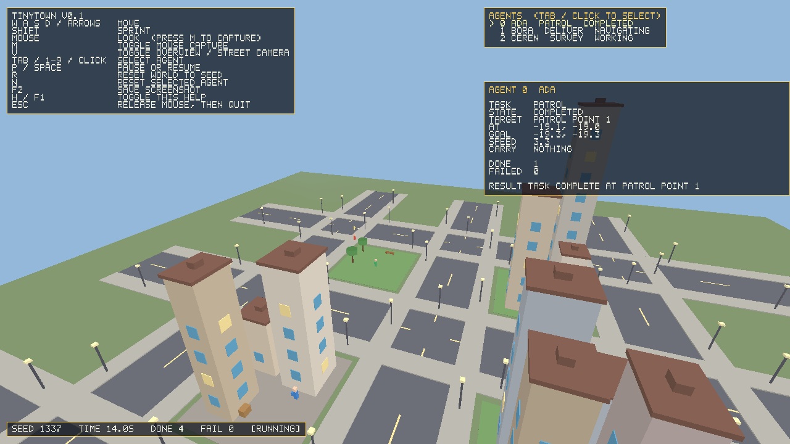

# TinyTown

**A tiny world built from code.**
*Küçük bir dünya; oyun motoru olmadan, kodla üretilir.*

TinyTown is a small open-source C++ experiment: a procedural 3D mini town, a
handful of visible agents doing simple deterministic work inside it, and a plain
overlay that shows what each agent is doing. It builds and runs without a game
engine, without a scripting runtime, and without any AI model or network access.



*Screenshot produced by the application itself
(`--screenshot docs/media/tinytown-v0.1-town.png`), not a concept image.*

## Status: v0.1 is implemented and runnable

Everything below was built and executed on Linux in this repository. Windows is
covered by CI compilation and a headless test run; see
[Platform support](#platform-support).

| Capability | State |
| --- | --- |
| CMake build (C++20, SDL2 + OpenGL) | Working |
| Procedural town from a seed | Working |
| First-person camera with collision and bounds | Working |
| 3+ agents with patrol / delivery / survey tasks | Working |
| Grid pathfinding that avoids buildings | Working |
| Agent inspect panel, agent list, help overlay, status line | Working |
| Pause, resume, reset world, reset one agent | Working |
| Headless simulation tests | 56 passing |
| Offscreen screenshot (`--screenshot`) | Working |
| Windows CI (MSVC) build + tests | Passing in CI (56/56 tests) |
| Audio, image/video export, AI adapters | **Not implemented** (later milestones) |

## Build

Requirements:

- CMake 3.16 or newer
- A C++20 compiler (tested with GCC 14; CI also targets MSVC 2022)
- SDL2 development files, version 2.32.x (zlib licence)
- An OpenGL development library
- Optional: zlib, for PNG screenshots. Without it, screenshots are written as PPM.

The build is verified against **SDL2 2.32.4**. SDL2 is the single external
dependency, and it is used only for the window, input, and OpenGL context.
Simulation, world generation, and pathfinding are plain C++ with no platform
headers; see [docs/ARCHITECTURE.md](docs/ARCHITECTURE.md) for why that line is
drawn where it is.

### Linux (verified)

```bash
# Debian/Ubuntu
sudo apt-get install -y cmake g++ libsdl2-dev libgl1-mesa-dev zlib1g-dev

cmake -S . -B build -DCMAKE_BUILD_TYPE=Release
cmake --build build --parallel
ctest --test-dir build --output-on-failure
./build/tinytown
```

### Windows (build instructions)

CI uses the official SDL2 development archive. The same steps work locally in a
Developer Command Prompt. The archive's top-level folder is `SDL2-<version>`
(not `SDL2-<version>-VC`), and its CMake package config lives in
`<root>\cmake\sdl2-config.cmake`:

```powershell
# Download and extract the SDL2-devel-2.32.4-VC.zip release to C:\SDL2
cmake -S . -B build -G "Visual Studio 17 2022" -A x64 `
      -DSDL2_DIR="C:\SDL2\cmake"
cmake --build build --config Release --parallel
ctest --test-dir build -C Release --output-on-failure
copy C:\SDL2\lib\x64\SDL2.dll build\Release\
.\build\Release\tinytown.exe
```

### Build options

| Option | Default | Effect |
| --- | --- | --- |
| `TINYTOWN_BUILD_APP` | `ON` | Build the interactive SDL2 application |
| `TINYTOWN_BUILD_TESTS` | `ON` | Build the headless test binary |

The tests have no SDL, OpenGL, or window dependency, so they run on any build
machine:

```bash
cmake -S . -B build -DTINYTOWN_BUILD_APP=OFF
cmake --build build --parallel
./build/tinytown_tests
```

## Run

```bash
./build/tinytown                 # default seed 1337, three agents
./build/tinytown --seed 42 --agents 5
```

### Controls

| Input | Action |
| --- | --- |
| `W` `A` `S` `D` or arrow keys | Move |
| `Shift` | Sprint |
| Mouse | Look (only after pressing `M`) |
| `M` | Toggle mouse capture |
| `Tab` or `1`–`9` | Select the next agent / a specific agent |
| Left click | Select the agent under the cursor |
| `P` or `Space` | Pause / resume the simulation |
| `R` | Reset the world and all agents to the current seed |
| `N` | Reset only the selected agent |
| `V` | Toggle overview camera / street camera |
| `H` or `F1` | Toggle the help overlay |
| `F2` | Save a screenshot to `captures/` |
| `Esc` | Release the mouse; press again to quit |

Mouse look is opt-in. The cursor is never warped and never trapped, and losing
focus clears all held keys and the mouse capture.

### Command-line options

```text
--seed <n>                 world seed (default 1337)
--agents <n>               number of agents (default 3)
--width <px> --height <px> window size (default 1280x720)
--screenshot <path>        render, write an image, and exit (no interaction)
--screenshot-seconds <s>   simulated seconds before the capture (default 3)
--yaw <radians>            initial camera yaw
--pitch <radians>          initial camera pitch
--camera <x> <z>           initial camera ground position
--eye <metres>             initial eye height; a high value starts overview mode
--print-agents             print agent task/state/target after a capture
--help                     show usage
```

## What the agents actually do

Each agent runs one of three deterministic behaviours, and the panel reports the
truthful current state:

- **Patrol** — walks a loop of sidewalk corners.
- **Deliver** — picks up a package at the Depot, carries it to a storefront, and
  returns. The carried package is drawn above the agent, so the panel and the
  world never disagree.
- **Survey** — travels to a landmark and inspects it.

States are `Idle → Navigating → Working → Completed` or `Failed`. A completed or
failed result stays on screen for a moment before the next task starts, so the
panel shows what actually happened. "No route" and "unknown target" are normal,
explicit outcomes: the agent records the reason, counts a failure, and picks up
its next task instead of walking through a building.

Verify the whole thing without a window:

```bash
./build/tinytown --screenshot /tmp/town.png --screenshot-seconds 14 \
    --camera 6 28 --yaw 0.35 --pitch -0.40 --eye 14 --print-agents
```

```text
Wrote /tmp/town.png (1280x720)
--- agent state at capture (t=14.02s) ---
  #0 Ada    task=Patrol   state=Completed  target=Patrol point 1 at=(-19.1, -19.0) done=1 failed=0 carry=nothing
  #1 Bora   task=Deliver  state=Navigating target=Depot (pickup) at=(-9.4, 12.0) done=2 failed=0 carry=nothing
  #2 Ceren  task=Survey   state=Working    target=Park Plaza     at=(-11.7, -11.7) done=1 failed=0 carry=nothing
```

## Tests

```bash
./build/tinytown_tests
```

The suite covers deterministic seeded world generation, pathfinding (reachable,
unreachable, blocked start/goal, out-of-bounds, detour around a wall, and
determinism), agent state transitions, large and negative `dt` handling, camera
frame-rate independence and bounds, session pause/selection/frame-clamping, and
the HUD bitmap font.

See [docs/QUALITY-GATES.md](docs/QUALITY-GATES.md) for the full acceptance list
and the last recorded results.

## Platform support

| Platform | Configured | Compiled | Tests run | Application launched |
| --- | --- | --- | --- | --- |
| Linux (GCC 13/14) | Yes | Yes | Yes — 56 passing | Yes, under Xvfb with Mesa llvmpipe |
| Windows (MSVC 2022) | Yes (CI) | Yes (CI) | Yes (CI) — 56 passing | **No** |

"Launched under Xvfb with Mesa llvmpipe" means the real binary created a real
OpenGL context, rendered frames, and wrote a real PNG. It is not a claim that a
human clicked through the interface on a desktop.

Windows is compiled and tested by CI on a GitHub-hosted runner (run
[39009303637](https://github.com/azmisahin-game/TinyTown/actions/runs/39009303637),
56/56 tests, zero warnings). That runner has no usable display or GPU, so the
interactive GUI and its OpenGL rendering have **not** been exercised on Windows;
the CI job only starts the executable with `--help` to check process start-up,
argument parsing and exit codes. macOS has not been configured or compiled at
all.

## Not implemented in v0.1

To be explicit, so the README never overstates the project:

- No audio, no image or video export, no MP4.
- No LLM, no TTS, no AI image model, no API keys, no network access.
- No in-app editor, scripting language, plugin system, or WebAssembly build.

These are separate later milestones, described in
[docs/ROADMAP.md](docs/ROADMAP.md).

## Dependencies and licences

| Dependency | Version | Licence | Why it is needed |
| --- | --- | --- | --- |
| SDL2 | 2.32.4 | zlib | Window, keyboard/mouse input, and OpenGL context on Windows, Linux, and macOS. Writing this per platform is far more code and more risk than one well-supported library. |
| OpenGL | system (`libGL`) | provided by the driver / Mesa | Drawing the scene. Used in compatibility-profile immediate mode, the same approach as the reference prototype. |
| zlib | 1.3.1 | zlib | Optional. Writes screenshots as PNG. The build works without it and falls back to PPM. |

There are no vendored binaries, no downloaded assets, and no model weights. Every
shape in the town is generated from code at startup.

## Repository layout

```text
src/core/      world generation, pathfinding, simulation, camera  (no graphics)
src/app/       main loop, session state, screenshot writing
src/render/    OpenGL renderer (reads simulation state, never decides it)
src/ui/        bitmap font and the HUD overlay
tests/         headless tests for everything above except the GL layer
reference/     the original Win32/OpenGL prototype, kept as history
docs/          vision, scope, architecture, roadmap, quality gates
```

## Why this exists

The project started from a single Win32/OpenGL C++ file. That file is preserved
in [`reference/win32-minicity/main.cpp`](reference/win32-minicity/README.md) as
history: it includes `<windows.h>` directly and cannot be compiled on Linux or
macOS as written. TinyTown keeps its intent — a small town you can walk through,
drawn entirely from code — and rebuilds it on a portable shell.

The design principle:

> The smallest whole thing that works, then only the complexity that a proven
> need requires.

Success is measured by whether someone can clone the repository, follow a few
commands, walk around the town, watch the agents work, understand what one of
them is doing, and reset the world. Not by line count.

## Documentation

- [Project vision](docs/PROJECT-VISION.md)
- [Product scope](docs/PRODUCT-SCOPE.md)
- [Architecture](docs/ARCHITECTURE.md)
- [Roadmap](docs/ROADMAP.md)
- [Quality gates and last results](docs/QUALITY-GATES.md)
- [Coding-agent task — Türkçe](docs/OPENHANDS-TASK-TR.md)
- [Coding-agent task — English](docs/OPENHANDS-TASK-EN.md)
- [Reference prototype](reference/win32-minicity/README.md)
